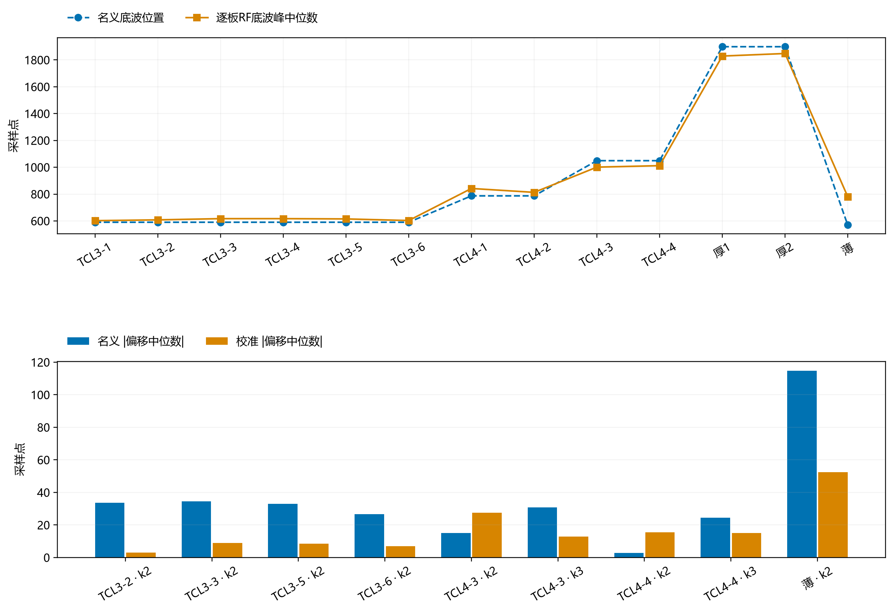

# V1.5.2 全板时间校准与冻结报告

本版本执行13板逐板RF校准，保留薄铝板900点模型输入、现有空间裁剪和V2标签。没有启动正式训练或outer性能评价。这里只冻结工程输入和预定开发判据下的中心选择，不声称物理回波身份、实际层厚/声速或分类性能已获独立验证。

## 全局决定

全部13板统一采用各自的校准中心。固定F1训练缺陷面板的深层216条/9单元完整：median(|偏移|) 28.885246 → 13.000000点；逐板/界面 |median(偏移)| 最大退步 12.590164点 ≤20。不按板看标签另选模式。

两个统计口径不同：总体用median(abs(offset))，逐单元保护用abs(median(offset))。深层固定身份不删、不换；任何深层观测缺失就不满足采用条件，全部板回退名义中心。



## RF-only定位与本轮协议修正

每板全部当前RF使用同一Hilbert包络定义：仅测时扣前16点中位基线、reflect-pad256，始波[0,200]峰；一次底波粗门±130点。除薄板外粗门沿用名义底波位置；薄板按用户约4μs设置粗门中心800点，实际仍由RF峰测量。无二次底波。正常/异常不区分，校准不读标签，原RF不修改。

每板始波与底波分别取有效中位数，Delta=(底波中位数−始波中位数)/(K+1)，tau_k=始波中位数+k Delta。同一板全部记录共享中心。不把逐条底波位置输入模型，也不以名义厚度/声速直接生成校准tau。

|板|K|RF条数|始波 中位/IQR|底波 中位/IQR|始波/底波失败|Delta|校准tau|底波门边峰数|
|---|---:|---:|---:|---:|---:|---:|---|---:|
|TCL3-1|2|274530|78.000/21.000|602.000/6.000|0/0|174.667|252.667, 427.333|9|
|TCL3-2|2|274608|74.000/3.000|608.000/11.000|0/0|178.000|252.000, 430.000|261|
|TCL3-3|2|275304|77.000/5.000|617.000/8.000|0/0|180.000|257.000, 437.000|873|
|TCL3-4|2|262581|72.000/3.000|617.000/12.000|0/0|181.667|253.667, 435.333|348|
|TCL3-5|2|275658|75.000/4.000|615.000/7.000|0/0|180.000|255.000, 435.000|699|
|TCL3-6|2|274010|75.000/6.000|603.000/5.000|0/0|176.000|251.000, 427.000|123|
|TCL4-1|3|248310|79.000/4.000|842.000/10.000|0/0|190.750|269.750, 460.500, 651.250|241|
|TCL4-2|3|249991|74.000/23.000|813.000/10.000|0/0|184.750|258.750, 443.500, 628.250|130|
|TCL4-3|3|249954|73.000/2.000|1001.000/11.000|0/0|232.000|305.000, 537.000, 769.000|0|
|TCL4-4|3|250000|74.000/2.000|1012.000/9.000|0/0|234.500|308.500, 543.000, 777.500|0|
|厚1|2|268805|78.000/3.000|1829.000/5.000|0/1591|583.667|661.667, 1245.333|796|
|厚2|2|201496|79.000/2.000|1848.000/4.000|0/0|589.667|668.667, 1258.333|440|
|薄|2|266072|79.000/19.000|781.000/5.000|0/0|234.000|313.000, 547.000|474|

薄板本轮底波781点=3.905μs，Delta234点，tau313/547点；旧519点候选及225.667/372.333中心属于已保留的旧阶段。厚1有1591条完整底波搜索门超出保存RF支持，保留失败计数，不缩窗拟峰；记录仍保留。

本轮退步的深层单元为TCL4-3第2界面和TCL4-4第2界面，分别退步12.410和12.590点；薄板的+114.753→−52.5仅指薄板第2界面。薄板名义底波仍为材料/名义厚度计算的569.620点，未改写成实测781点。其900点输入来自明确的fixed_prefix_samples_by_entity覆盖项；其他12板仍沿用原固定长度，截断长度不随本轮底波中位数变化。

## 固定共同观测门与D偏移

在本轮D标签重新读取前，先固定每板512条等距RF样本的q99包络模板。仅取200点以后、抽样底波前80点之前的显著峰（最小间距80，prominence≥3原始单位），按最近均分界面序号关联，容差0.4个层间隔；同序号取模板幅值最大峰，缺失不补。实际模板峰确定共同观测门中心、半宽80，相邻门在中点裁开。

同一条验证RF只在该固定共同门内找一次包络峰，再同时减名义/校准tau。两个目标不分别寻峰。模板与锚点都来自同一开发RF，序号关联使用均分假设，存在模板选择偏倚；valid仅表示门内可计算有限非零候选，不能理解为物理回波已辨识。

原query07 F1训练缺陷固定384条/16单元，每单元24条；source身份及可靠标签重新核对。首界面168条仅报告，其中48条因RF模板缺失保持缺失，未重选；深层216条/9单元全部观测。深层门边0、低幅(<3原始单位)0；薄板首界面有1次门边命中。

|板|k|观测/请求|失败|名义 中位/IQR|校准 中位/IQR|名义±80|校准±80|门边/低幅|
|---|---:|---:|---:|---:|---:|---:|---:|---:|
|TCL3-2|1|0/24|24|缺失/缺失|缺失/缺失|缺失|缺失|0/0|
|TCL3-2|2|24/24|0|33.557/4.250|-3.000/4.250|100.0%|100.0%|0/0|
|TCL3-3|1|24/24|0|50.279/3.000|-10.000/3.000|100.0%|100.0%|0/0|
|TCL3-3|2|24/24|0|34.557/5.250|-9.000/5.250|100.0%|100.0%|0/0|
|TCL3-5|1|24/24|0|49.779/5.500|-8.500/5.500|100.0%|100.0%|0/0|
|TCL3-5|2|24/24|0|33.057/5.000|-8.500/5.000|100.0%|100.0%|0/0|
|TCL3-6|1|24/24|0|47.279/4.000|-7.000/4.000|100.0%|100.0%|0/0|
|TCL3-6|2|24/24|0|26.557/4.250|-7.000/4.250|100.0%|100.0%|0/0|
|TCL4-3|1|0/24|24|缺失/缺失|缺失/缺失|缺失|缺失|0/0|
|TCL4-3|2|24/24|0|-15.090/2.250|-27.500/2.250|100.0%|100.0%|0/0|
|TCL4-3|3|24/24|0|-30.885/6.250|-13.000/6.250|100.0%|100.0%|0/0|
|TCL4-4|1|24/24|0|35.705/1.250|-10.500/1.250|100.0%|100.0%|0/0|
|TCL4-4|2|24/24|0|2.910/3.000|-15.500/3.000|100.0%|100.0%|0/0|
|TCL4-4|3|24/24|0|-24.385/4.500|-15.000/4.500|100.0%|100.0%|0/0|
|薄|1|24/24|0|80.127/4.500|-43.000/4.500|41.7%|91.7%|1/0|
|薄|2|24/24|0|114.753/10.250|-52.500/10.250|0.0%|100.0%|0/0|

### 3 mm板第一界面单列

|板|观测/请求|名义中位偏移|校准中位偏移|门边|
|---|---:|---:|---:|---:|
|TCL3-2|0/24|缺失|缺失|0|
|TCL3-3|24/24|50.279|-10.000|0|
|TCL3-5|24/24|49.779|-8.500|0|
|TCL3-6|24/24|47.279|-7.000|0|
|薄|24/24|80.127|-43.000|1|

旧名义±130观察门抓到始波或前一界面的结果保留在原阶段。本轮换为RF模板共同门，观察口径已变，不能把两轮汇总直接拼成同一指标进步曲线；总体中位数恰为相同数值也不改变这一点。薄板本轮k2的名义偏移中位数+114.753、校准−52.5；不是把旧门约264点前波继续当该界面验证。

## 输入、先验与能量统计

本地窗±80点，Gaussian sigma40点、强度0.5。训练时每条记录各界面共享Uniform±24整体窗口抖动，四Head使用同一seed23/epoch/source身份序列，RF不移动；验证/测试不抖动。Local/Pre/Gaussian/能量窗同移。薄板模型输入900点，其余板保持691/887/1150/1999点。v1.5.1有效长度分组整批主干不变，无时间拉伸。

同一唯一完整可靠F1训练cohort 3,836,015界面重新拟合：mean=-7.07515099127469、std=0.98169499693968，ddof0；正常和缺陷都包含，前能量窗[0,180]、epsilon1e-8、固定除131。基础统计不抖动，训练能量使用实际抖动窗口。拟合与runtime都使用与模型相同的float32元数据还原端点。

只因薄板中心改变，其基础特征数组发生变化；其余6个训练板基础数组和所有cohort身份不变。共享标准化系数改变会影响所有板的标准化token，不能把“其他板RF未改”说成全部模型输入token不变。

M6保留原冻结禁用决定，没有重新做注意力训练/选择。Local mask的离散支持验证不代表主干非因果感受野或GroupNorm实现了原始RF因果隔离。

## 测试与发布边界

- 工作树全量pytest：{'tests': 417, 'failures': 0, 'errors': 0, 'skipped': 0}。
- 全3,371,319条RF锚点数组分位数重算、26条独立NumPy FFT锚点、384条D的独立FFT同峰重算；固定216深层完整性与全局判据复算通过。
- 384条真实RF在旧v1.5.1输入策略下RF/meta/info逐位一致；全源最坏±24窗口边界通过。四Head用真实混合长度691/1150/900/691仅前向，padding不影响有效特征，Local能量支持精确一致，实际冻结epoch1端点反例复核通过；没有真实数据优化器更新。
- 远端13板RF全文SHA与本地匹配；薄板新完整RF独立版本文件已到位。空间mask、标签/mask/eligible、40epoch/validation身份沿用，原数据和旧STOP保留。
- 全量校准cache与RF catalog/粗门上下文绑定，改变粗门后不能误复用；该防误用保护不改变本轮已经完成的测量值。
- 图中统计单位为采样点，深层图是9个板-界面单元的开发性描述，没有独立性能置信区间或外层模型结果。

## 可复查文件与运行

[校准表](../artifacts/v1.5.2/rf_calibration.json) · [选用中心及SHA](../artifacts/v1.5.2/timebase.json) · [RF观测门](../artifacts/v1.5.2/observation_gates.json) · [验证摘要](../artifacts/v1.5.2/validation_summary.json) · [训练统计](../artifacts/v1.5.2/physical_normalization.json) · [数据清单](../artifacts/v1.5.2/data_manifest.json) · [校验清单](../artifacts/v1.5.2/checksums.json)。

Git只含现有代码/配置及必要小型校准/统计/报告，不含RF、身份映射数组、checkpoint或私有凭据。完整无标签访问审计、逐记录测时/验证RF、训练特征及独立审查轨迹保存在外部A3证据库。本轮经用户授权为已知13板各自无标签RF校准；此前厚板标签示例的开发暴露事实保留，不能称外层标签从未查看。

SSH版本包从确切提交导出，代码目录包含artifacts/v1.5.2；在目标机目录内运行物化脚本，三个产物路径解析为目标机代码目录下的文件。核对Git导出产物的字节SHA、配置绑定、SOURCE_REVISION及包内逐文件SHA，执行CPU单元测试和CUDA仅前端前向检查。旧版本目录不覆盖，新目录保留STOP和训练许可false。

SOURCE_REVISION由打包脚本根据已核验tag提交生成，是部署元数据。catalog_signature包含input_config及板的科学字段，不包含可迁移的index_dir/rf_path；重定位前后另核对签名一致，文件内容用逐文件SHA核验。13板完整RF哈希检查见独立remote_RF_verified.json，安装时另查文件大小，不冒称又做了一次全文哈希。薄板的nominal_bottom、selected_bottom和固定输入长度分别是569.620、781、900点，承担名义参照、校准锚点、输入截断三个职责。

使用已有数据与冻结选择绑定可移植模板（输出保持训练关闭）：

```text
python scripts/a3_v152_materialize.py --template configs/experiment/v1_5_2_freeze.json --catalog <CATALOG> --epoch-root <EPOCH_ROOT> --validation-root <VALIDATION_ROOT> --source-commit <EXACT_TAG_COMMIT> --output <NEW_RUNTIME_CONFIG>
```

正式训练启动为后续用户动作；本版本发布/SSH更新不自动运行四格，不沿用旧checkpoint。本报告不将位置校准开发判据通过等同于分类效果改善。
